# Khoj Video Analyzer: Backend Architecture & Integration Guide
**Service URL:** `https://khoj-video-analyzer-988501677320.us-central1.run.app`  
**Health Check:** `https://khoj-video-analyzer-988501677320.us-central1.run.app/health`  
**Interactive API Docs:** `https://khoj-video-analyzer-988501677320.us-central1.run.app/docs`  

---

## 1. Executive Summary & Purpose

### 1.1 Context & Problem Statement
In Bangladesh's digital landscape, misinformation has shifted predominantly from static text articles to **multimedia video content** (viral YouTube videos, Facebook Watch clips, TikToks, and Instagram Reels). Misinformation spreaders exploit speech nuances, misleading captions, and provocative thumbnails to evade simple keyword-based text filters.

Traditional fact-checking platforms fail on video claims because:
1. Video media streams are bandwidth-intensive and slow to process.
2. Major video platforms (especially YouTube) aggressively block cloud datacenter IP addresses (GCP, AWS, Azure) using BotGuard and anti-bot verification challenges (`Sign in to confirm you're not a bot`).
3. Spoken Bengali contains regional dialects, slang, and phonetically ambiguous words that standard Latin speech-to-text models fail to transcribe accurately.

### 1.2 Purpose of `khoj-video-analyzer`
`khoj-video-analyzer` is a high-speed, standalone, containerized microservice deployed on Google Cloud Run. It acts as the dedicated multimedia intelligence engine for the **Khoj Ecosystem** (Android Mobile App & Next.js Web App).

Its primary responsibilities are:
- Ingesting video URLs across YouTube, Facebook, Instagram, Twitter/X, and TikTok without getting blocked by bot-walls.
- Extracting exact, verbatim spoken speech transcripts with millisecond-accurate timestamps.
- Performing visual on-screen OCR to capture editor banners, breaking news headlines, and embedded subtitles.
- Post-processing speech transcripts through state-of-the-art LLMs (Nvidia Nemotron 550B Ultra) to normalize colloquial Bengali speech into clean, punctuated, fact-checkable claims.

---

## 2. Under-the-Hood Architecture & Working Mechanism

```mermaid
flowchart TD
    User([User Submits Video URL / File]) --> Router{Platform Detection}
    
    %% YouTube Route
    Router -->|YouTube URL| YT_Engine[Tier 1: InnerTube Android Engine]
    YT_Engine --> Proxy[Webshare Egress Gateway]
    Proxy --> YT_Player[YouTube /youtubei/v1/player]
    
    YT_Player -->|Captions Present?| TimedText[Direct TimedText XML Ingestion]
    YT_Player -->|No Captions?| AudioStream[Tier 2: Mobile Audio Stream Download]
    
    %% Social Route
    Router -->|Facebook / TikTok / Reels| SocialDownloader[Tier 2: Low-Bitrate Stream Downloader]
    
    %% Audio STT
    AudioStream --> Whisper[Faster-Whisper int8 STT Engine]
    SocialDownloader --> Whisper
    
    %% Video OCR (Optional)
    Router -.->|OCR Enabled?| FrameSampler[OpenCV Frame Sampler]
    FrameSampler --> Tesseract[Tesseract OCR Engine - ben+eng]
    
    %% Post Processing
    TimedText --> LLM_Refiner[Tier 3: Nvidia Nemotron 550B Ultra LLM]
    Whisper --> LLM_Refiner
    
    %% Final Synthesis
    LLM_Refiner --> SummaryBuilder[Fact-Check Summary Synthesizer]
    Tesseract --> SummaryBuilder
    
    SummaryBuilder --> Output([Unified Fact-Check Payload])
```



### 2.1 YouTube Anti-Bot Bypass Mechanics (InnerTube Android + Webshare Egress)
YouTube aggressively challenges anonymous datacenter traffic on its desktop web client (`WEB`). The backend bypasses this entirely using:
1. **InnerTube Android Client Emulation:** Instead of requesting full web pages, the backend sends a lightweight JSON handshake to `https://www.youtube.com/youtubei/v1/player` mimicking the official YouTube Android mobile client (`com.google.android.youtube/20.10.38`).
2. **Webshare Egress Gateway (`YT_PROXY`):** The InnerTube handshake is routed through a dedicated egress proxy. This masks Google Cloud Run's datacenter IP (`34.x.x.x`), prompting YouTube to return `playabilityStatus: OK` without any BotGuard or CAPTCHA barriers.
3. **Hybrid TimedText Fetching:** The player endpoint provides a signed `baseUrl` for pre-existing human subtitles or auto-generated captions (`kind=asr`). Crucially, the signed URL specifies `ip=0.0.0.0`, enabling the backend to download the caption payload directly without consuming proxy bandwidth.

### 2.2 Uncaptioned Video Fallback (Faster-Whisper ASR)
If a video has no pre-existing captions (e.g., brand-new upload <15 minutes old, music clip, or raw footage):
1. The service uses `yt-dlp` configured with mobile client prioritization (`android,ios,web`) and routes the stream request through the egress proxy.
2. It strictly downloads the lowest-bitrate audio stream (`32-64kbps` M4A/Opus), keeping download sizes under 2–3 MB even for 10-minute videos.
3. The audio is decoded in-memory and transcribed using a quantized Bengali speech-to-text model: `ammaraldirawi/faster-whisper-small-bn-int8`.

### 2.3 Visual OCR Layer
For videos featuring breaking news lower-thirds, text overlays, or editor graphics, the service samples frames at configurable intervals (`2.0s` default, max 25 frames) and runs dual-language OCR (`ben+eng`) using OpenCV and Tesseract.

### 2.4 LLM Linguistic Refinement (Nvidia Nemotron 550B Ultra & Gemini Flash)
Raw spoken transcripts often contain speech artifacts (e.g., phonetic transliterations like "জিপিটি সোল" instead of "জিপিটি-৪", or "বাঘ" instead of "বাগ (software bug)").
The raw text is automatically passed to OpenRouter's **Nvidia Nemotron 550B Ultra** model (`nvidia/nemotron-3-ultra-550b-a55b:free`) or Gemini 2.5 Flash-Lite, which:
- Corrects phonetic mistranscriptions.
- Inserts proper Bengali punctuation (দাঁড়ি, কমা, উদ্ধৃতি চিহ্ন).
- Formats speech into coherent paragraphs ready for fact-check verification.

### 2.5 Unified Single-Download Media Stream & Parallel Multi-Modal Pipeline
For full composite analysis (`/analyze`), traditional pipelines trigger two consecutive downloads: first for audio, then for video. This doubles network transfer time and frequently trips platform anti-bot tripwires on the second download.
`khoj-video-analyzer` employs a single unified 360p download pipeline:
1. Downloads a single 360p MP4 stream containing both synchronized audio tracks and visual frames.
2. Dispatches `audio_task` (Whisper transcription) and `ocr_task` (OpenCV + Tesseract) concurrently using Python's `asyncio.gather`.
3. Cuts total network transfer latency by **50%** and completely eliminates secondary-download bot triggers.

### 2.6 Instagram Anti-Bot Resilience & Rotating Mobile User-Agents
Social media platforms (especially Instagram Reels and Facebook) actively monitor cloud datacenter IP ranges. The extractor incorporates:
- **3-Tier User-Agent Rotation with Random Jitter:** Automatically fails over from Desktop Chrome to Mobile Safari (iPhone) and Mobile Android Chrome with randomized backoff delays (1.2s to 2.2s).
- **Netscape Cookie Injection:** Ingests persistent session cookies from `cookies/merged_cookies.txt` (or environment variables `YT_COOKIES_BASE64` / `YT_COOKIES_TEXT`), granting authenticated access and bypassing login-wall redirects.

### 2.7 Source Caption & Post Text Extraction (`source_caption`)
Fact-checkers must examine both what is spoken in the video and what was written by the person sharing it (captions, tweets, or descriptions often contain the core viral claim).
- The crawler captures the human-written post text across Instagram, Facebook, X/Twitter, TikTok, and YouTube into the `source_caption` field.
- If no caption was written by a human, `source_caption` safely defaults to `null`.
- In synthesized fact-check summaries, it is automatically formatted as:
  ```text
  Information about that video collected from the source:
  <source_caption text>
  ```

## 3. API Reference

### 3.1 Base Configuration
- **Base URL:** `https://khoj-video-analyzer-988501677320.us-central1.run.app`
- **Protocol:** HTTPS (TLS 1.3)
- **Authentication:** Publicly accessible on Cloud Run (`allow-unauthenticated`). Internal rate-limiting and maximum duration guardrails (`MAX_VIDEO_DURATION_SECONDS = 900`) apply.

---

### 3.2 Endpoint: Analyze Video URL
`POST /analyze`

Analyzes any public video URL from YouTube, Facebook, Instagram, Twitter/X, or TikTok.

#### Request Headers
```http
Content-Type: application/json
```

#### Request Body
```json
{
  "url": "https://youtu.be/NwquG0Uf1As",
  "extract_audio": true,
  "extract_ocr": false,
  "language": "bn"
}
```

| Field | Type | Required | Default | Description |
| :--- | :--- | :--- | :--- | :--- |
| `url` | String | Yes | - | Public URL of the target video. |
| `extract_audio` | Boolean | No | `true` | Whether to extract spoken transcript via Captions or Whisper STT. |
| `extract_ocr` | Boolean | No | `true` | Whether to perform visual frame OCR on lower-thirds and banners. |
| `language` | String | No | `null` | Target language (`"bn"` for Bengali, `"en"` for English, or `null` for auto). |

#### Response Schema (`200 OK`)
```json
{
  "success": true,
  "platform": "youtube",
  "video_id": "NwquG0Uf1As",
  "title": "বাংলাদেশ ব্যাংকের ওয়েবসাইটের এই অবস্থা কেন?",
  "author": "Khalid Farhan",
  "duration_seconds": 203,
  "thumbnail_url": "https://i.ytimg.com/vi/NwquG0Uf1As/sddefault.jpg",
  "source_caption": "জরুরী আপডেটঃ বাংলাদেশ ব্যাংকের অফিশিয়াল সাইট বন্ধ হওয়ার মূল কারণ...",
  "spoken_transcript": "জরুরী ভিডিও। যখন আমি এই ভিডিও রেকর্ড করছি, এই মুহূর্তে বাংলাদেশ ব্যাংকের ওয়েবসাইট বন্ধ...",
  "raw_spoken_transcript": "জরুরী ভিডিও। যখন আমি এই ভিডিও রেকর্ড করছি এই মুহূর্তে বাংলাদেশ ব্যাংকের ওয়েবসাইট বন্ধ...",
  "refiner_model": "nvidia/nemotron-3-ultra-550b-a55b:free",
  "spoken_segments": [
    {
      "start": 0.08,
      "end": 3.68,
      "text": "জরুরী ভিডিও। যখন আমি এই ভিডিও রেকর্ড"
    },
    {
      "start": 2.08,
      "end": 6.4,
      "text": "করছি এই মুহূর্তে বাংলাদেশ ব্যাংকের"
    }
  ],
  "on_screen_text": [],
  "merged_content_for_factcheck": "Video Title: বাংলাদেশ ব্যাংকের ওয়েবসাইটের এই অবস্থা কেন?\nSource/Author: Khalid Farhan (Youtube)\n\nInformation about that video collected from the source:\nজরুরী আপডেটঃ বাংলাদেশ ব্যাংকের অফিশিয়াল সাইট বন্ধ হওয়ার মূল কারণ...\n\n[Spoken Transcript (Audio)]:\nজরুরী ভিডিও...",
  "detected_language": "bn",
  "processing_time_seconds": 1.25,
  "message": "Analysis completed successfully."
}
```

---

### 3.3 Endpoint: Speech-to-Text Transcription Only
`POST /transcribe`

Ultra-fast transcription endpoint for audio/speech fact-checking. Downloads strictly the audio stream and executes Whisper STT + LLM refinement with **zero video download and zero frame OCR**.

#### Request Body
```json
{
  "url": "https://youtu.be/NwquG0Uf1As",
  "language": "bn"
}
```

#### Response Schema (`200 OK`)
```json
{
  "success": true,
  "platform": "youtube",
  "video_id": "NwquG0Uf1As",
  "title": "বাংলাদেশ ব্যাংকের ওয়েবসাইটের এই অবস্থা কেন?",
  "author": "Khalid Farhan",
  "duration_seconds": 203,
  "thumbnail_url": "https://i.ytimg.com/vi/NwquG0Uf1As/sddefault.jpg",
  "source_caption": "জরুরী আপডেটঃ বাংলাদেশ ব্যাংকের অফিশিয়াল সাইট বন্ধ হওয়ার মূল কারণ...",
  "spoken_transcript": "জরুরী ভিডিও। যখন আমি এই ভিডিও রেকর্ড করছি...",
  "raw_spoken_transcript": "জরুরী ভিডিও...",
  "refiner_model": "nvidia/nemotron-3-ultra-550b-a55b:free",
  "spoken_segments": [...],
  "detected_language": "bn",
  "processing_time_seconds": 0.85,
  "message": "Audio transcription completed successfully."
}
```

---

### 3.4 Endpoint: Visual Banner OCR Only
`POST /ocr`

Dedicated visual text overlay recognition. Downloads only the lightweight 360p video frames and samples keyframe banners with **zero audio download and zero Whisper model execution**.

#### Request Body
```json
{
  "url": "https://youtu.be/NwquG0Uf1As",
  "interval_seconds": 2.5,
  "max_frames": 16
}
```

#### Response Schema (`200 OK`)
```json
{
  "success": true,
  "platform": "youtube",
  "video_id": "NwquG0Uf1As",
  "title": "বাংলাদেশ ব্যাংকের ওয়েবসাইটের এই অবস্থা কেন?",
  "author": "Khalid Farhan",
  "duration_seconds": 203,
  "thumbnail_url": "https://i.ytimg.com/vi/NwquG0Uf1As/sddefault.jpg",
  "source_caption": "জরুরী আপডেট...",
  "on_screen_text": [
    {
      "start": "00:02",
      "end": "00:08",
      "text": "ব্রেকিং নিউজ: বাংলাদেশ ব্যাংকের সার্ভার ডাউন"
    }
  ],
  "combined_visual_text": "ব্রেকিং নিউজ: বাংলাদেশ ব্যাংকের সার্ভার ডাউন",
  "frames_analyzed": 16,
  "processing_time_seconds": 1.45,
  "message": "Visual OCR extraction completed (1 text segments found)."
}
```

---

### 3.5 Endpoints: Direct File Uploads
For local video or audio files from user storage:
- `POST /transcribe/upload`: Multipart upload for speech transcription only.
- `POST /ocr/upload`: Multipart upload for visual OCR on video frames.
- `POST /analyze/upload`: Multipart upload for full composite analysis.

#### Request Headers
```http
Content-Type: multipart/form-data
```

#### Form Fields
- `file`: Binary file stream.
- `extract_audio`: `true` (default).
- `extract_ocr`: `false` (default for audio files).
- `language`: `"bn"`.

---

## 4. Mobile App Integration (Android / Kotlin)

### 4.1 Architecture in `khoj-app`
In the Android application, the video fact-checking feature integrates seamlessly into the existing `FactCheckViewModel` and `ClaimExtractor` pipeline:

```
User Pastes Video URL
       ↓
VideoAnalyzerClient.analyzeUrl(url)
       ↓
Returns VideoAnalyzeResponse
       ↓
Display Video Preview (Thumbnail, Channel, Title)
       ↓
Pass `merged_content_for_factcheck` to ClaimExtractor
       ↓
DeepSearchEngine (SearXNG / Google / NewsData)
       ↓
FactCheckEngine (Gemini 2.5 Flash / Groq)
       ↓
Display Fact-Check Verdict & Citations
```

---

### 4.2 Step 1: Add API URL to `BuildConfig`
In `app/build.gradle.kts`:

```kotlin
buildConfigField("String", "VIDEO_ANALYZER_URL", "\"https://khoj-video-analyzer-988501677320.us-central1.run.app\"")
```

---

### 4.3 Step 2: Data Models (`VideoAnalyzerModels.kt`)
Create `app/src/main/java/com/example/data/model/VideoAnalyzerModels.kt`:

```kotlin
package com.example.data.model

import com.google.gson.annotations.SerializedName

data class VideoAnalyzeRequest(
    @SerializedName("url") val url: String,
    @SerializedName("extract_audio") val extractAudio: Boolean = true,
    @SerializedName("extract_ocr") val extractOcr: Boolean = false,
    @SerializedName("language") val language: String? = "bn"
)

data class SpokenSegment(
    @SerializedName("start") val start: Double,
    @SerializedName("end") val end: Double,
    @SerializedName("text") val text: String
)

data class OnScreenTextItem(
    @SerializedName("start") val start: String,
    @SerializedName("end") val end: String,
    @SerializedName("text") val text: String
)

data class VideoAnalyzeResponse(
    @SerializedName("success") val success: Boolean,
    @SerializedName("platform") val platform: String,
    @SerializedName("video_id") val videoId: String? = null,
    @SerializedName("title") val title: String,
    @SerializedName("author") val author: String,
    @SerializedName("duration_seconds") val durationSeconds: Int,
    @SerializedName("thumbnail_url") val thumbnailUrl: String?,
    @SerializedName("source_caption") val sourceCaption: String? = null,
    @SerializedName("spoken_transcript") val spokenTranscript: String,
    @SerializedName("raw_spoken_transcript") val rawSpokenTranscript: String?,
    @SerializedName("refiner_model") val refinerModel: String?,
    @SerializedName("spoken_segments") val spokenSegments: List<SpokenSegment>,
    @SerializedName("on_screen_text") val onScreenText: List<OnScreenTextItem>,
    @SerializedName("merged_content_for_factcheck") val mergedContentForFactCheck: String,
    @SerializedName("detected_language") val detectedLanguage: String,
    @SerializedName("processing_time_seconds") val processingTimeSeconds: Double,
    @SerializedName("message") val message: String?
)

data class TranscribeResponse(
    @SerializedName("success") val success: Boolean,
    @SerializedName("platform") val platform: String,
    @SerializedName("video_id") val videoId: String? = null,
    @SerializedName("title") val title: String,
    @SerializedName("author") val author: String,
    @SerializedName("duration_seconds") val durationSeconds: Int,
    @SerializedName("thumbnail_url") val thumbnailUrl: String?,
    @SerializedName("source_caption") val sourceCaption: String? = null,
    @SerializedName("spoken_transcript") val spokenTranscript: String,
    @SerializedName("raw_spoken_transcript") val rawSpokenTranscript: String?,
    @SerializedName("refiner_model") val refinerModel: String?,
    @SerializedName("spoken_segments") val spokenSegments: List<SpokenSegment>,
    @SerializedName("detected_language") val detectedLanguage: String,
    @SerializedName("processing_time_seconds") val processingTimeSeconds: Double,
    @SerializedName("message") val message: String?
)
```

---

### 4.4 Step 3: API Client (`VideoAnalyzerClient.kt`)
Create `app/src/main/java/com/example/data/api/VideoAnalyzerClient.kt`:

```kotlin
package com.example.data.api

import com.example.BuildConfig
import com.example.data.model.VideoAnalyzeRequest
import com.example.data.model.VideoAnalyzeResponse
import com.example.data.model.TranscribeResponse
import com.google.gson.Gson
import kotlinx.coroutines.Dispatchers
import kotlinx.coroutines.withContext
import okhttp3.MediaType.Companion.toMediaType
import okhttp3.Request
import okhttp3.RequestBody.Companion.toRequestBody
import java.util.concurrent.TimeUnit

object VideoAnalyzerClient {
    private val client = NetworkClientProvider.ocrAndLlmClient.newBuilder()
        .connectTimeout(30, TimeUnit.SECONDS)
        .readTimeout(120, TimeUnit.SECONDS)
        .writeTimeout(30, TimeUnit.SECONDS)
        .build()

    private val gson = Gson()
    private val jsonMediaType = "application/json; charset=utf-8".toMediaType()

    /**
     * Determines whether a given URL is a supported video platform link.
     */
    fun isVideoUrl(url: String): Boolean {
        val lower = url.lowercase().trim()
        return lower.contains("youtube.com") || lower.contains("youtu.be") ||
               lower.contains("fb.watch") || lower.contains("facebook.com") ||
               lower.contains("instagram.com") || lower.contains("tiktok.com") ||
               lower.contains("twitter.com") || lower.contains("x.com")
    }

    /**
     * Analyzes video URL using the full composite Cloud Run pipeline (/analyze).
     */
    suspend fun analyzeVideo(url: String, extractOcr: Boolean = true): VideoAnalyzeResponse? = withContext(Dispatchers.IO) {
        val baseUrl = BuildConfig.VIDEO_ANALYZER_URL.trimEnd('/')
        val endpoint = "$baseUrl/analyze"

        val requestPayload = VideoAnalyzeRequest(
            url = url,
            extract_audio = true,
            extract_ocr = extractOcr,
            language = "bn"
        )

        val request = Request.Builder()
            .url(endpoint)
            .post(gson.toJson(requestPayload).toRequestBody(jsonMediaType))
            .build()

        try {
            client.newCall(request).execute().use { response ->
                val bodyString = response.body?.string() ?: return@withContext null
                if (!response.isSuccessful) return@withContext null
                gson.fromJson(bodyString, VideoAnalyzeResponse::class.java)
            }
        } catch (e: Exception) {
            android.util.Log.e("VideoAnalyzerClient", "Video analysis failed: ${e.message}")
            null
        }
    }

    /**
     * Ultra-fast transcription of speech only (/transcribe) with zero video frames sampled.
     */
    suspend fun transcribeVideo(url: String, language: String? = "bn"): TranscribeResponse? = withContext(Dispatchers.IO) {
        val baseUrl = BuildConfig.VIDEO_ANALYZER_URL.trimEnd('/')
        val endpoint = "$baseUrl/transcribe"
        val payload = mapOf("url" to url, "language" to language)

        val request = Request.Builder()
            .url(endpoint)
            .post(gson.toJson(payload).toRequestBody(jsonMediaType))
            .build()

        try {
            client.newCall(request).execute().use { response ->
                val bodyString = response.body?.string() ?: return@withContext null
                if (!response.isSuccessful) return@withContext null
                gson.fromJson(bodyString, TranscribeResponse::class.java)
            }
        } catch (e: Exception) {
            android.util.Log.e("VideoAnalyzerClient", "Video transcription failed: ${e.message}")
            null
        }
    }
}
```

---

### 4.5 Step 4: ViewModel Integration (`FactCheckViewModel.kt`)
In `FactCheckViewModel.kt`, detect if the user's input query is a video link before initiating the standard search flow:

```kotlin
fun onVerifyClaim(query: String) {
    viewModelScope.launch {
        _uiState.value = FactCheckUiState.Loading("অ্যানালাইসিস করা হচ্ছে...")

        if (VideoAnalyzerClient.isVideoUrl(query)) {
            _uiState.value = FactCheckUiState.Loading("ভিডিওর বক্তব্য ও টেক্সট সংগ্রহ করা হচ্ছে...")
            val videoResult = VideoAnalyzerClient.analyzeVideo(query)

            if (videoResult != null && videoResult.spokenTranscript.isNotBlank()) {
                // 1. Update UI with Video Preview Metadata
                _videoMetadata.value = VideoMetadataState(
                    title = videoResult.title,
                    author = videoResult.author,
                    thumbnailUrl = videoResult.thumbnailUrl,
                    transcript = videoResult.spokenTranscript,
                    segments = videoResult.spokenSegments
                )

                // 2. Pass synthesized content to ClaimExtractor
                _uiState.value = FactCheckUiState.Loading("বক্তব্যের মূল দাবিগুলো যাচাই করা হচ্ছে...")
                val extractedClaim = ClaimExtractor.extractClaim(videoResult.mergedContentForFactCheck)

                // 3. Continue to standard FactCheckEngine verification
                executeFactCheckPipeline(extractedClaim, videoResult.mergedContentForFactCheck)
                return@launch
            }
        }

        // Standard text/image verification flow
        executeFactCheckPipeline(query, null)
    }
}
```

---

### 4.6 Step 5: Compose UI Component (`VideoFactCheckCard.kt`)
Display a video card above the verdict so the user can verify what the speaker said:

```kotlin
@Composable
fun VideoFactCheckCard(
    metadata: VideoMetadataState,
    modifier: Modifier = Modifier
) {
    var expanded by remember { mutableStateOf(false) }

    Card(
        modifier = modifier.fillMaxWidth(),
        shape = RoundedCornerShape(16.dp),
        colors = CardDefaults.cardColors(containerColor = MaterialTheme.colorScheme.surfaceVariant)
    ) {
        Column(modifier = Modifier.padding(16.dp)) {
            Row(verticalAlignment = Alignment.CenterVertically) {
                AsyncImage(
                    model = metadata.thumbnailUrl,
                    contentDescription = "Video Thumbnail",
                    modifier = Modifier.size(80.dp, 60.dp).clip(RoundedCornerShape(8.dp)),
                    contentScale = ContentScale.Crop
                )
                Spacer(modifier = Modifier.width(12.dp))
                Column {
                    Text(
                        text = metadata.title,
                        style = MaterialTheme.typography.titleMedium.copy(
                            platformStyle = PlatformTextStyle(includeFontPadding = true),
                            lineHeightStyle = LineHeightStyle(LineHeightStyle.Alignment.Center, LineHeightStyle.Trim.None)
                        ),
                        maxLines = 2,
                        overflow = TextOverflow.Ellipsis
                    )
                    Text(
                        text = "চ্যানেল/উৎস: ${metadata.author}",
                        style = MaterialTheme.typography.bodySmall,
                        color = MaterialTheme.colorScheme.onSurfaceVariant
                    )
                }
            }

            Spacer(modifier = Modifier.height(12.dp))

            // Expandable Spoken Transcript
            Text(
                text = if (expanded) metadata.transcript else metadata.transcript.take(180) + "...",
                style = MaterialTheme.typography.bodyMedium.copy(
                    platformStyle = PlatformTextStyle(includeFontPadding = true),
                    lineHeight = 22.sp
                )
            )

            TextButton(onClick = { expanded = !expanded }) {
                Text(text = if (expanded) "কম দেখুন" else "সম্পূর্ণ বক্তব্য দেখুন")
            }
        }
    }
}
```

---

## 5. Web App Integration (Next.js / TypeScript)

### 5.1 Route Handler (`app/api/video-analyzer/route.ts`)
Create a Next.js API route that proxies requests to Cloud Run:

```typescript
import { NextRequest, NextResponse } from 'next/server';

const VIDEO_ANALYZER_BACKEND = process.env.VIDEO_ANALYZER_BACKEND_URL || 'https://khoj-video-analyzer-988501677320.us-central1.run.app';

export async function POST(req: NextRequest) {
  try {
    const { url, extract_ocr } = await req.json();

    if (!url) {
      return NextResponse.json({ success: false, error: 'URL is required' }, { status: 400 });
    }

    const backendRes = await fetch(`${VIDEO_ANALYZER_BACKEND}/analyze`, {
      method: 'POST',
      headers: { 'Content-Type': 'application/json' },
      body: JSON.stringify({
        url,
        extract_audio: true,
        extract_ocr: extract_ocr ?? false,
        language: 'bn',
      }),
      cache: 'no-store',
    });

    if (!backendRes.ok) {
      const errorText = await backendRes.text();
      return NextResponse.json({ success: false, error: errorText }, { status: backendRes.status });
    }

    const data = await backendRes.json();
    return NextResponse.json(data);
  } catch (error: any) {
    return NextResponse.json({ success: false, error: error.message || 'Internal Server Error' }, { status: 500 });
  }
}
```

---

## 6. Edge Cases & Resilience Strategy

| Edge Case | Backend Behavior | Client Handling |
| :--- | :--- | :--- |
| **YouTube Video has Auto-Captions** | Instant extraction via InnerTube Android API (<1.5s total time). | Shows instant results with millisecond segments. |
| **Video Has No Captions / New Upload** | Falls back to low-bitrate audio download via proxy, followed by Faster-Whisper ASR. | Displays `Processing Time: ~15-20s` with a progress indicator. |
| **Instagram Reel Anti-Bot Throttling** | Fails over through rotating Desktop and Mobile iPhone/Android User-Agents with 1.2s-2.2s jitter + Netscape cookies. | Resilient download with zero manual intervention required. |
| **Facebook/Twitter Video Post** | Directly extracts audio stream and human-written caption/tweet text. | Captures text claim into `source_caption` alongside spoken audio. |
| **Video Has No Human Caption** | Crawlers safely detect absence of text and return `source_caption: null`. | Frontend skips caption box; fact-check prompt focuses on transcript. |
| **Pure Audio / Speech Fast Ingestion** | Client can target `POST /transcribe` directly to bypass video frames. | Shaves 40–50% off request latency and compute resources. |
| **Video is Private / Deleted** | Returns HTTP 200 with `success: false` and explanatory `message`. | Prompts user: "ভিডিওটি প্রাইভেট অথবা ডিলিট করা হয়েছে।" |
| **Video Exceeds Max Duration (>15m)** | Caps audio extraction to first 15 minutes to prevent compute exhaustion. | Analyzes the initial 15-minute claims. |
| **Offline Video File (WhatsApp/Camera)** | Handled via `POST /analyze/upload` or `POST /transcribe/upload`. | Allows user to pick local MP4/MP3 from device storage. |

---

## 7. Service Maintenance & Verification

### Checking Health & Models
```bash
curl -X GET https://khoj-video-analyzer-988501677320.us-central1.run.app/health
```

### Live CLI Verification
```bash
curl -X POST https://khoj-video-analyzer-988501677320.us-central1.run.app/analyze \
  -H "Content-Type: application/json" \
  -d '{"url": "https://youtu.be/NwquG0Uf1As", "extract_audio": true, "extract_ocr": false}'
```

### Cloud Shell Redeployment (if updating settings)
```bash
cd ~/khoj-video-analyzer && git pull && ./deploy.sh
```
